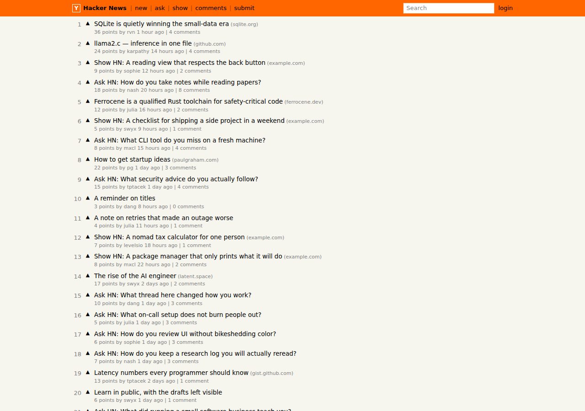
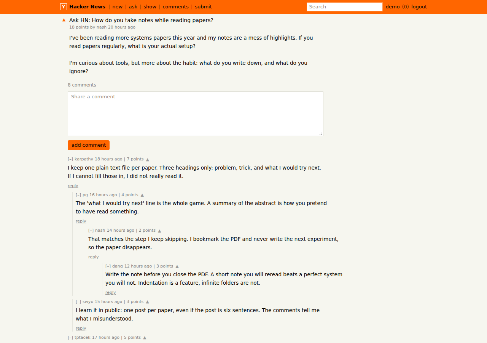
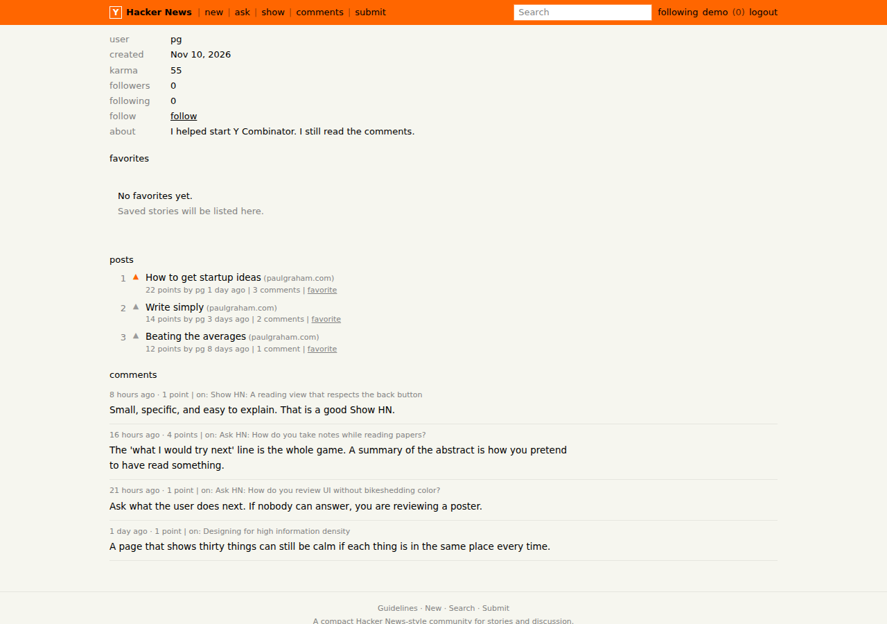
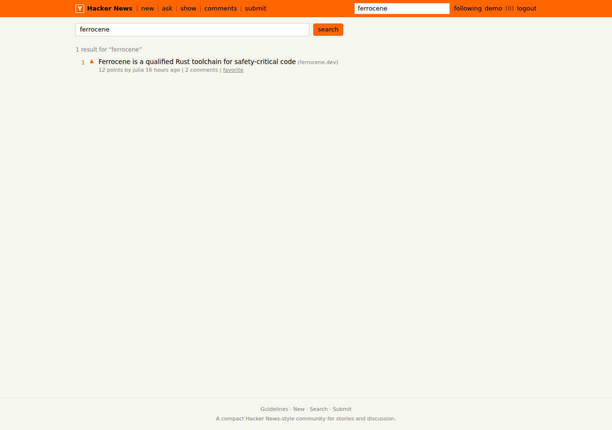
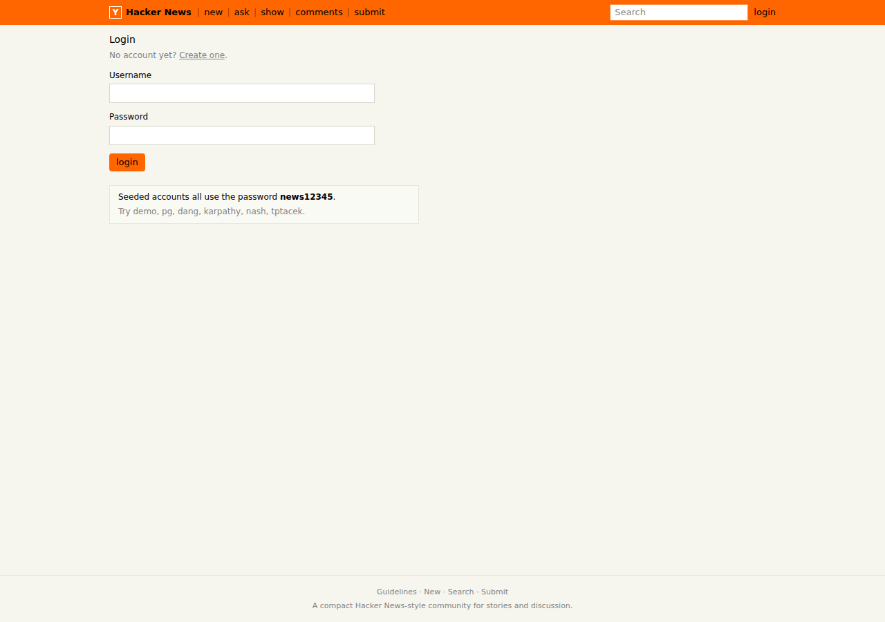
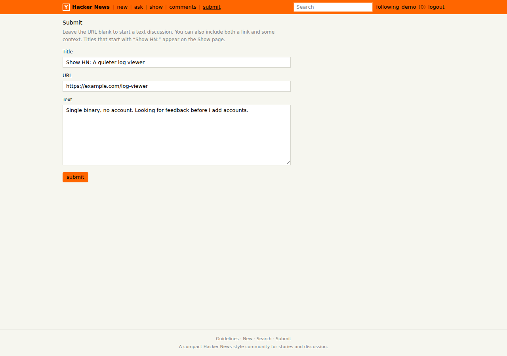
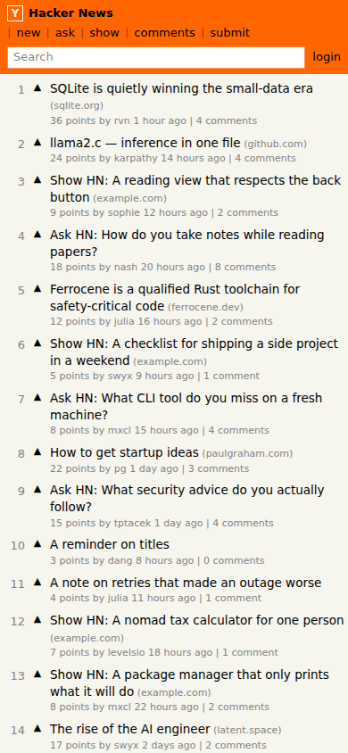

# Hacker News

一个可运行的 Hacker News 风格社区精简版：发帖、投票、热度排序、多层评论、搜索、收藏、关注和个人主页。

## 技术栈

- Next.js 15（App Router）+ React 19 + TypeScript
- Prisma 6 + SQLite
- Tailwind CSS 4
- 会话：HttpOnly cookie 中的 JWT（`jose`），密码使用 scrypt
- 测试：Vitest（单元）+ Playwright（端到端，使用本机 Chrome）

## 功能

- 注册、登录、退出。不能投票给自己的帖子或评论，可以取消已投的票。
- 发布帖子：标题，外加 URL、正文，或两者都有。标题以 `Show HN:` 开头会出现在 Show 页；不填 URL 的文字帖出现在 Ask 页。
- 首页按热度排序，New 页按时间排序，每页 30 条，底部有 More。
- 热度使用经典公式 `(points - 1) / (ageHours + 2) ^ 1.8`。帖子分数相同则较新的在前。
- 搜索标题和正文，忽略大小写；多个词需要同时命中。标题匹配优先于正文匹配。
- 空状态、加载骨架和表单错误提示。

### 评论

- 多层回复最多 8 层，可以折叠。折叠状态保存在当前浏览器会话的 `sessionStorage`（键 `hn-collapsed-comments`）。刷新或离开后再回来仍然折叠；新会话全部展开。
- 排序规则：先按票数降序，票数相同再按时间升序（更早的在前）。票数和时间都相同则按 id 字典序。没有票的线程因此仍是从旧到新。
- 登录用户可以给别人的评论 upvote，再点一次取消。不能给自己的评论投票，也不能给已软删除的评论投票。
- Karma 是别人投给你的帖子票和评论票之和。自己投自己的不计。取消评论票会把对应 karma 减回去。软删除不撤销已经投出的票，karma 保持原样。
- 作者可以在发表后 15 分钟内（含整 15 分钟）编辑自己的评论。超时、别人的评论、未登录或已删除都会被拒绝。编辑后页面显示 `edited`。
- 作者可以随时软删除自己的评论。页面和接口对外显示「已删除」，回复留在树里，不能再编辑或投票。原文仍留在数据库里，不再发回浏览器。

### 收藏和关注

- 登录用户可以收藏或取消收藏帖子，包括自己的帖子。收藏不改变点数，也不改变 karma。
- 个人主页有收藏列表，按收藏时间从新到旧，最多 50 条。
- 登录用户可以关注或取消关注其他用户。不能关注自己。
- 个人主页显示 followers 和 following。自己看自己的主页没有关注按钮。
- 登录后顶栏有 `/following`。这个页面只列出你关注的人发布的帖子，仍按首页热度排序。还没关注任何人时是空状态；未登录访问会要求先登录。

### 速率限制和重复内容

限制在服务端执行。超限返回 `Too many requests. Try again in N seconds.`

| 动作 | 上限 | 窗口 |
| --- | --- | --- |
| 发帖 | 8 | 10 分钟 |
| 评论 | 20 | 10 分钟 |
| 投票（帖子和评论共用） | 60 | 1 分钟 |

重复检测先把文本规范化：转成小写，并把标点换成空格。然后在滑动窗口里和同一用户最近的内容比较。规范化后完全相同，或者字符 bigram 的 Dice 相似度 ≥ 0.9，就拒绝。

- 发帖窗口 60 分钟，标题或正文命中时返回 `You recently submitted a very similar post.`
- 评论窗口 10 分钟，未删除评论命中时返回 `You recently posted a very similar comment.`
- 空字符串不算重复。窗口外的旧内容不参与比较。

输入边界：标题去掉空白后 1 到 120 字；帖子必须有 URL 或正文；URL 只能是 http/https，最长 500；正文最长 5000；评论去掉空白后 1 到 4000 字。emoji、中文和 `<script>` 按普通文本保存。

## 本地启动

```bash
npm install
npx prisma migrate deploy
npm run db:seed
npm run dev
```

浏览器打开 [http://localhost:3000](http://localhost:3000)。

`npm run db:seed` 会清空并重建 SQLite 数据。数据库文件在 `prisma/dev.db`（路径相对于 Prisma schema）。

### 环境变量

`.env` 不进入 Git。第一次在本地跑之前，从示例文件生成它，并换成自己的密钥：

```bash
cp .env.example .env
node -e "console.log(require('crypto').randomBytes(32).toString('base64url'))"
```

把打印出来的字符串填进 `.env` 的 `AUTH_SECRET`。应用在启动时检查这个值：缺失、仍是 `CHANGE_ME_TO_A_LONG_RANDOM_STRING` 这类占位符，或短于 32 个字符时，进程会把原因打到 stderr 并退出，不会再用内置的弱默认值签名。生产环境必须使用单独生成的随机值。

单元测试和端到端测试会自己设置合规的 `AUTH_SECRET`，不读取这份本地文件。`npm run db:seed` 只依赖 `DATABASE_URL`。

### 演示账号

所有种子账号的密码都是 `news12345`。

可以试 `demo`、`pg`、`dang`、`karpathy`、`nash`、`tptacek`。`lurker` 是一个还没有发过帖的账号，用来看空状态。

## 测试

```bash
npm run lint
npm run typecheck
npm test
npm run test:e2e
```

- `npm test` 覆盖热度排序和分页、评论排序与 karma、编辑删除、折叠、收藏关注、速率限制、重复检测、输入边界、密码和会话。
- `npm run test:e2e` 会迁移并灌入独立的 `prisma/e2e.db`，然后构建生产版本并在 3100 端口跑关键流程：注册登录、发帖、投票、评论和嵌套回复、评论投票、编辑删除、折叠、搜索、热度/最新排序、Ask/Show 过滤、个人主页、收藏和关注。需要已安装 Google Chrome。
- 规模测量（220 篇帖子、1100 条评论，写入临时数据库，不碰开发库）：

```bash
npx tsx scripts/scale-bench.ts
```

## 自检文档

- [RANKING_VERIFICATION.md](RANKING_VERIFICATION.md)
- [COMMENT_SYSTEM.md](COMMENT_SYSTEM.md)
- [USER_INTERACTIONS.md](USER_INTERACTIONS.md)
- [SAFETY_AND_LIMITS.md](SAFETY_AND_LIMITS.md)
- [SCALE_TEST.md](SCALE_TEST.md)
- [FINAL_AUDIT.md](FINAL_AUDIT.md)
- [SECURITY_CLEANUP.md](SECURITY_CLEANUP.md)

## 截图

服务跑起来之后，可以用 `node scripts/capture-screenshots.mjs` 重新生成这些图。

首页（热度排序）：



帖子详情和四层嵌套评论：



用户主页：



搜索：



登录：



发帖：



窄屏首页：



## 目录

- `app/(feed)/` 首页、`newest`、`ask`、`show`、`comments`、`search`、`following`
- `app/(account)/` `login`、`register`、`submit`
- `app/item/[id]/` 帖子和评论
- `app/user/[username]/` 个人主页（karma、followers、following、收藏、帖子、评论）
- `app/guidelines/`
- `components/` 列表、投票、评论树、收藏按钮、关注按钮、表单
- `lib/domain/` 热度 `ranking.ts`、分页 `pagination.ts`、评论树 `comments.ts`、编辑删除 `comment-moderation.ts`、收藏关注 `social.ts`、速率 `rate-limit.ts`、重复检测 `duplicate.ts`、搜索、karma
- `lib/actions/auth.ts`、`lib/actions/posts.ts`、`lib/actions/comments.ts`、`lib/actions/votes.ts`、`lib/actions/social.ts`
- `lib/auth-secret.ts` 与 `instrumentation.ts`：启动时拒绝缺失、占位符或过短的 `AUTH_SECRET`
- `prisma/` schema、迁移和种子数据
- `scripts/scale-bench.ts` 规模测量，`scripts/capture-screenshots.mjs` 截图
- `tests/unit`、`tests/e2e`
