# Hacker News

## 安全警告

历史提交里曾经包含 `.env`。那把 `AUTH_SECRET` 长 31 个字符，短于现在要求的 32，而且不是占位符。任何人都能从旧提交里读到它。严禁继续使用那把密钥，也不要使用本仓库示例里的占位符。

本地和生产都必须各自生成一把新的、至少 32 个字符的随机密钥：

```bash
openssl rand -base64 32
node -e "console.log(require('crypto').randomBytes(32).toString('base64url'))"
```

把结果写入只存在于本机的 `.env`。启动时会拒绝缺失、占位符或短于 32 个字符的值。清理历史的可执行步骤在 [HISTORY_CLEANUP_V2.md](HISTORY_CLEANUP_V2.md)。本仓库没有执行历史重写。

一个可运行的 Hacker News 风格社区精简版：发帖、投票、热度排序、多层评论、搜索、收藏、关注和个人主页。

## 技术栈

- Next.js 15（App Router）+ React 19 + TypeScript
- Prisma 6 + SQLite
- Tailwind CSS 4
- 会话：HttpOnly cookie 中的 JWT（`jose`），密码使用 scrypt
- 测试：Vitest（单元）+ Playwright（端到端，使用本机 Chrome）

## 功能

- 注册、登录、退出。邮箱验证是可选的，默认关闭（不设置 `REQUIRE_EMAIL_VERIFICATION`）。默认 `MAILER=console`，把信打在服务器日志里，持续集成不依赖付费邮件服务。生产可以改成 `MAILER=smtp`。注册时如果信发不出去，账号仍然留下并保持未验证，验证页可以重发。忘记密码可以要一封一小时内有效的重置信。已登录用户可以在自己的主页申请更换邮箱：确认信发到新地址，旧地址在点开链接之前保持不变，发信失败也不会改掉它。申请时和确认后都会给旧地址发一封不含链接的通知；通知发不出去不挡住更换。确认信发不出去时，这次的令牌哈希会被清掉。这不要求打开 `REQUIRE_EMAIL_VERIFICATION`。不能投票给自己的帖子或评论，可以取消已投的票。
- 发布帖子：标题，外加 URL、正文，或两者都有。标题以 `Show HN:` 开头会出现在 Show 页；不填 URL 的文字帖出现在 Ask 页。
- 可以给别人的帖子和评论 upvote 或 downvote。页面上的分数按票数相加，可以是负数。热度排序把低于 0 的分数按 0 算。Karma 按帖子和评论分开累计，每一侧低于 0 时按 0 算。downvote 至少需要 1 点 karma（`DOWNVOTE_MIN_KARMA`）。
- 首页按热度排序，New 页按时间排序，每页 30 条，底部有 More。
- 热度使用经典公式 `(points - 1) / (ageHours + 2) ^ 1.8`。帖子分数相同则较新的在前。默认在内存里排序。`RANKING_BACKEND=sql` 把热度和 Newest 下推到 SQL，见 [RANKING_DB.md](RANKING_DB.md) 和 [RANKING_EXTEND.md](RANKING_EXTEND.md)。
- 搜索标题和正文，忽略大小写；多个词需要同时命中。标题匹配优先于正文匹配。SQL 先筛出候选，再用同一套 `searchRelevance` 打分，只装载当前页，见 [SEARCH_SCALE.md](SEARCH_SCALE.md)。
- 空状态、加载骨架和表单错误提示。

### 评论

- 多层回复最多 16 层，可以折叠。第 16 层不再显示回复入口。缩进每层 12 像素，到 120 像素后不再变宽。第 11 到 16 层缩进都停在 120 像素，作者名前面用橙色数字标出层数。这几层不再叠加左边框和内边距，避免缩进到顶之后还往右挪。已登录用户的折叠写入数据库，换浏览器后仍在。未登录用户写在这个浏览器的 `localStorage`（键 `hn-collapsed-comments`），关掉标签页后再打开仍在，见 [COMMENT_COLLAPSE.md](COMMENT_COLLAPSE.md)。
- 排序规则：先按票数降序，票数相同再按时间升序（更早的在前）。票数和时间都相同则按 id 字典序。没有票的线程因此仍是从旧到新。
- 登录用户可以给别人的评论 upvote 或 downvote，再点一次取消。不能给自己的评论投票，也不能给已软删除的评论投票。
- Karma 是别人投给你的帖子票和评论票之和，downvote 记为负。自己投自己的不计。帖子侧和评论侧各自低于 0 时按 0 算。取消评论票会把对应 karma 减回去。软删除不撤销已经投出的票，karma 保持原样。
- 作者可以在发表后 15 分钟内（含整 15 分钟）编辑自己的评论。超时、别人的评论、未登录或已删除都会被拒绝。编辑后页面显示 `edited`。
- 作者可以随时软删除自己的评论。页面和接口对外显示「已删除」，回复留在树里，不能再编辑或投票。原文仍留在数据库里，不再发回浏览器。

评论投票后，箭头是已投票状态：

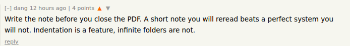

软删除后正文显示「已删除」：

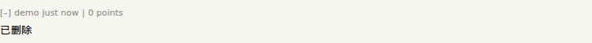

### 收藏和关注

- 登录用户可以收藏或取消收藏帖子，包括自己的帖子。收藏不改变点数，也不改变 karma。
- 个人主页有收藏列表，按收藏时间从新到旧，最多 50 条。
- 登录用户可以关注或取消关注其他用户。不能关注自己。
- 个人主页显示 followers 和 following。自己看自己的主页没有关注按钮。
- 登录后顶栏有 `/following`。这个页面只列出你关注的人发布的帖子，仍按首页热度排序。还没关注任何人时是空状态；未登录访问会要求先登录。

个人主页里的收藏列表：

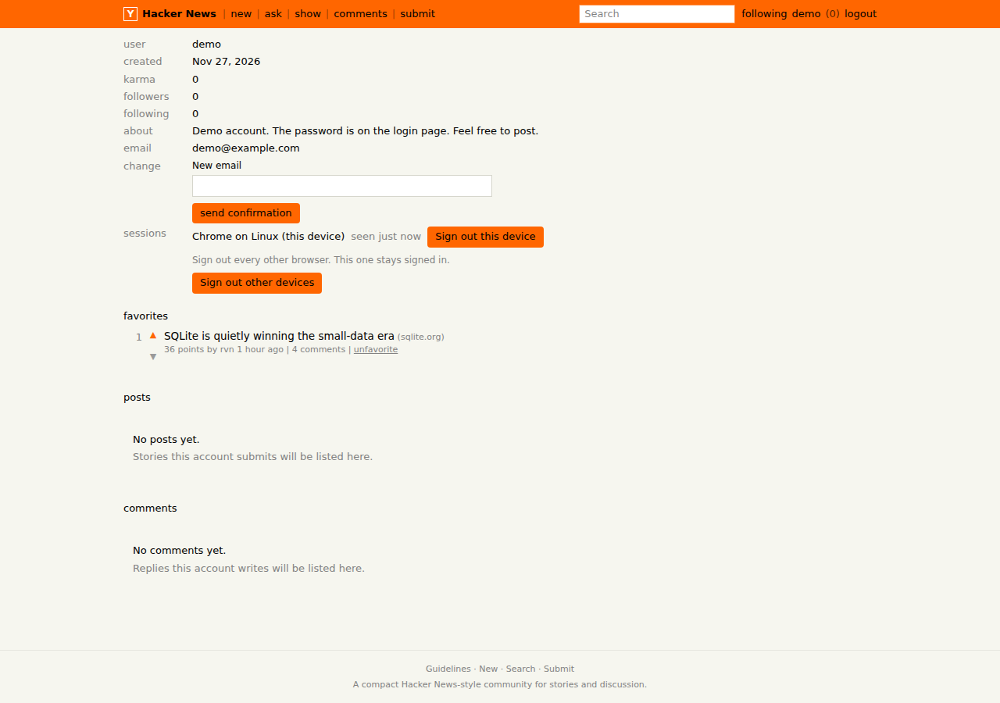

个人主页上的粉丝数和关注数。下面这张是 demo 关注 pg 之后，pg 的 followers 变成 1：

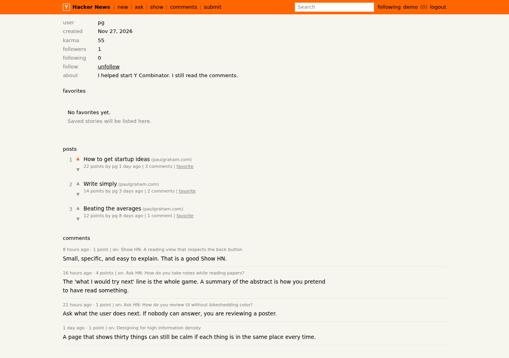

`/following` 只显示被关注作者的帖子：

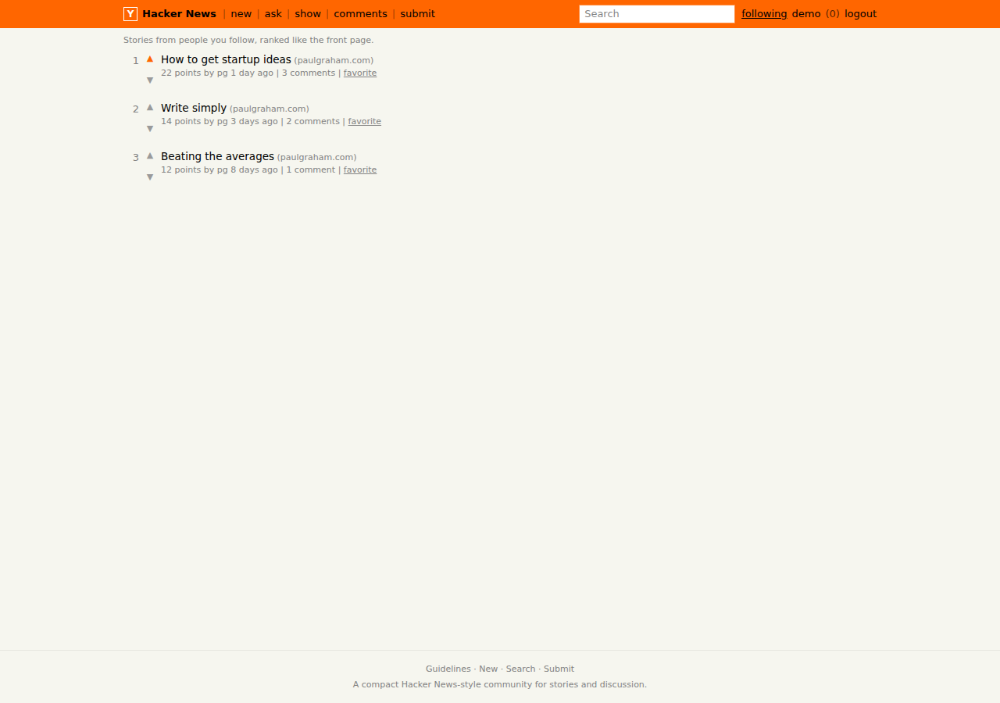

### 速率限制和重复内容

限制在服务端执行。超限返回 `Too many requests. Try again in N seconds.` 默认记在进程内存里。`RATE_LIMIT_BACKEND=sqlite` 改记到单独的 SQLite 文件，见 [RATE_LIMIT_PERSISTENCE.md](RATE_LIMIT_PERSISTENCE.md)。`RATE_LIMIT_BACKEND=redis` 加 `REDIS_URL` 则记到 Redis，检查和计数是一次 Lua `EVAL`，见 [RATE_LIMIT_REDIS.md](RATE_LIMIT_REDIS.md) 和 [REDIS_ATOMIC.md](REDIS_ATOMIC.md)。Redis 连不上时请求被拒绝，不会悄悄退回内存。

| 动作 | 上限 | 窗口 |
| --- | --- | --- |
| 发帖 | 8 | 10 分钟 |
| 评论 | 20 | 10 分钟 |
| 投票（帖子和评论共用） | 60 | 1 分钟 |

重复检测先把文本规范化：转成小写，并把标点换成空格。然后在滑动窗口里和同一用户最近的内容比较。规范化后完全相同，或者字符 bigram 的 Dice 相似度 ≥ 0.9，就拒绝。

- 发帖窗口 60 分钟，标题或正文命中时返回 `You recently submitted a very similar post.`
- 评论窗口 10 分钟，未删除评论命中时返回 `You recently posted a very similar comment.`
- 空字符串不算重复。窗口外的旧内容不参与比较。

输入边界：标题去掉空白后 1 到 120 字；帖子必须有 URL 或正文；URL 只能是 http/https，最长 500；正文最长 5000；评论去掉空白后 1 到 4000 字。emoji、中文和 `<script>` 按普通文本保存。

## 本地启动

```bash
npm install
npx prisma migrate deploy
npm run db:seed
npm run dev
```

浏览器打开 [http://localhost:3000](http://localhost:3000)。

`npm run db:seed` 会清空并重建 SQLite 数据。数据库文件在 `prisma/dev.db`（路径相对于 Prisma schema）。

### 环境变量

`.env` 不进入 Git。第一次在本地跑之前，从示例文件生成它，并换成一把全新的密钥。旧的 `AUTH_SECRET` 已经出现在历史提交里，严禁继续使用；生成方法和清理历史的步骤见 [HISTORY_CLEANUP.md](HISTORY_CLEANUP.md)。

```bash
cp .env.example .env
openssl rand -base64 32
node -e "console.log(require('crypto').randomBytes(32).toString('base64url'))"
```

把打印出来的字符串填进 `.env` 的 `AUTH_SECRET`。它必须是新生成的随机值，至少 32 个字符。也可以用 `openssl rand -base64 32`。应用在启动时检查这个值：缺失、仍是 `PLACEHOLDER_REPLACE_WITH_A_NEW_SECRET` 这类占位符，或短于 32 个字符时，进程会把原因打到 stderr 并退出，不会再用内置的弱默认值签名。生产环境必须单独再生成一把，不能复用本地或历史里的值。

单元测试和端到端测试会自己设置合规的 `AUTH_SECRET`，不读取这份本地文件。`npm run db:seed` 只依赖 `DATABASE_URL`。

### 演示账号

所有种子账号的密码都是 `news12345`。

可以试 `demo`、`pg`、`dang`、`karpathy`、`nash`、`tptacek`。`lurker` 是一个还没有发过帖的账号，用来看空状态。

## 测试

```bash
npm run lint
npm run typecheck
npm test
npm run test:e2e
```

- `npm test` 覆盖热度排序和分页、评论排序与 karma、编辑删除、折叠、收藏关注、速率限制、重复检测、输入边界、密码和会话。
- `npm run test:e2e` 会迁移并灌入独立的 `prisma/e2e.db`，然后构建生产版本并在 3100 端口跑关键流程：注册登录、发帖、投票、评论和嵌套回复、评论投票、编辑删除、折叠、搜索、热度/最新排序、Ask/Show 过滤、个人主页、收藏和关注。需要已安装 Google Chrome。
- 规模测量（220 篇帖子、1100 条评论，写入临时数据库，不碰开发库）：

```bash
npx tsx scripts/scale-bench.ts
```

## 自检文档

- [RANKING_VERIFICATION.md](RANKING_VERIFICATION.md)
- [COMMENT_SYSTEM.md](COMMENT_SYSTEM.md)
- [USER_INTERACTIONS.md](USER_INTERACTIONS.md)
- [SAFETY_AND_LIMITS.md](SAFETY_AND_LIMITS.md)
- [SCALE_TEST.md](SCALE_TEST.md)
- [FINAL_AUDIT.md](FINAL_AUDIT.md)
- [SECURITY_CLEANUP.md](SECURITY_CLEANUP.md)

第四轮补充了密钥历史、速率限制存储、数据库迁移和热度排序的说明：

- [HISTORY_CLEANUP.md](HISTORY_CLEANUP.md)
- [RATE_LIMIT_PERSISTENCE.md](RATE_LIMIT_PERSISTENCE.md)
- [DB_MIGRATION.md](DB_MIGRATION.md)
- [RANKING_SCALABILITY.md](RANKING_SCALABILITY.md)
- [FOURTH_ROUND_AUDIT.md](FOURTH_ROUND_AUDIT.md)

第五轮补充了历史清理命令、Redis 速率限制、PostgreSQL CI 和 SQL 热度排序：

- [HISTORY_CLEANUP_V2.md](HISTORY_CLEANUP_V2.md)
- [RATE_LIMIT_REDIS.md](RATE_LIMIT_REDIS.md)
- [POSTGRES_CI.md](POSTGRES_CI.md)
- [RANKING_DB.md](RANKING_DB.md)
- [FIFTH_ROUND_AUDIT.md](FIFTH_ROUND_AUDIT.md)

第六轮把 Redis 限流收成一次调用，让单元测试连上 PostgreSQL，并补了迁移 SQL 和 Newest 的 SQL 排序：

- [REDIS_ATOMIC.md](REDIS_ATOMIC.md)
- [POSTGRES_TESTS.md](POSTGRES_TESTS.md)
- [POSTGRES_MIGRATION.md](POSTGRES_MIGRATION.md)
- [RANKING_EXTEND.md](RANKING_EXTEND.md)
- [SIXTH_ROUND_AUDIT.md](SIXTH_ROUND_AUDIT.md)

第七轮在空 PostgreSQL 上执行迁移 SQL，缩小搜索装载范围，把已登录用户的评论折叠写入数据库，并让 `npm run dev` 在密钥不合格时返回工作进程的退出码：

- [POSTGRES_MIGRATE_APPLY.md](POSTGRES_MIGRATE_APPLY.md)
- [SEARCH_SCALE.md](SEARCH_SCALE.md)
- [COMMENT_COLLAPSE.md](COMMENT_COLLAPSE.md)
- [PRODUCTION_DEFAULTS.md](PRODUCTION_DEFAULTS.md)
- [SEVENTH_ROUND_AUDIT.md](SEVENTH_ROUND_AUDIT.md)

第八轮加上可选的邮箱验证、反对票，把评论深度上限改成 16，并收掉搜索打分、未登录折叠和 `npx next dev` 的遗留限制：

- [EMAIL_VERIFICATION.md](EMAIL_VERIFICATION.md)
- [DOWNVOTES.md](DOWNVOTES.md)
- [COMMENT_DEPTH.md](COMMENT_DEPTH.md)
- [LEFTOVER_HARDENING.md](LEFTOVER_HARDENING.md)
- [EIGHTH_ROUND_AUDIT.md](EIGHTH_ROUND_AUDIT.md)

第九轮加上可切换的 SMTP 发信、发信失败后的账号政策、限时密码重置、非 ASCII 搜索折叠，并收紧很大年龄上的热度精度和深层评论的层数标记：

- [EMAIL_DELIVERY.md](EMAIL_DELIVERY.md)
- [PASSWORD_RESET.md](PASSWORD_RESET.md)
- [SEARCH_UNICODE.md](SEARCH_UNICODE.md)
- [LEFTOVER_HARDENING_V2.md](LEFTOVER_HARDENING_V2.md)
- [NINTH_ROUND_AUDIT.md](NINTH_ROUND_AUDIT.md)

第十轮在密码重置后作废旧会话，让 `ß` 和 `SS` 走同一套搜索折叠，加上限时的邮箱更换，并收掉深层评论到顶后的多余边距：

- [SESSION_REVOKE.md](SESSION_REVOKE.md)
- [SEARCH_FOLD_V2.md](SEARCH_FOLD_V2.md)
- [ACCOUNT_EMAIL_CHANGE.md](ACCOUNT_EMAIL_CHANGE.md)
- [LEFTOVER_HARDENING_V3.md](LEFTOVER_HARDENING_V3.md)
- [TENTH_ROUND_AUDIT.md](TENTH_ROUND_AUDIT.md)

## 截图

服务跑起来之后，可以用 `node scripts/capture-screenshots.mjs` 重新生成这些图。

首页（热度排序）：

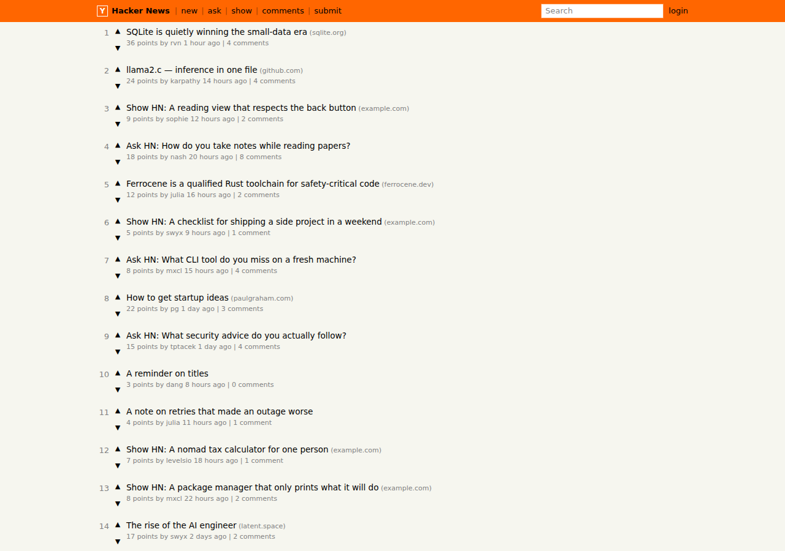

帖子详情和四层嵌套评论：

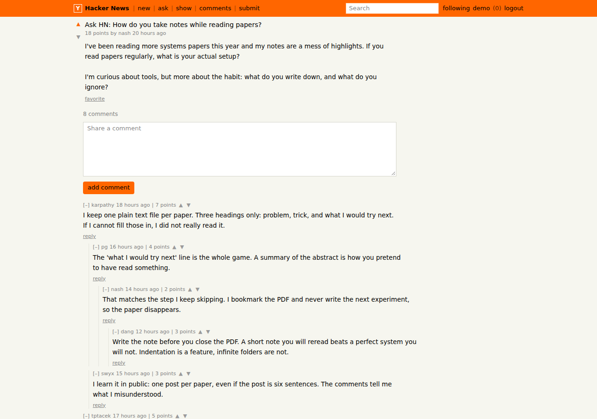

用户主页：

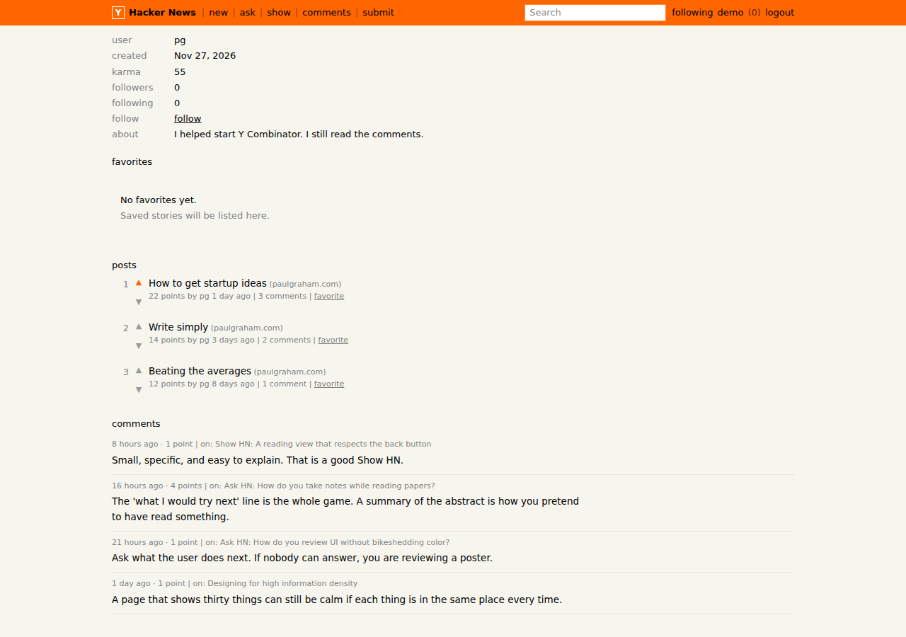

搜索：

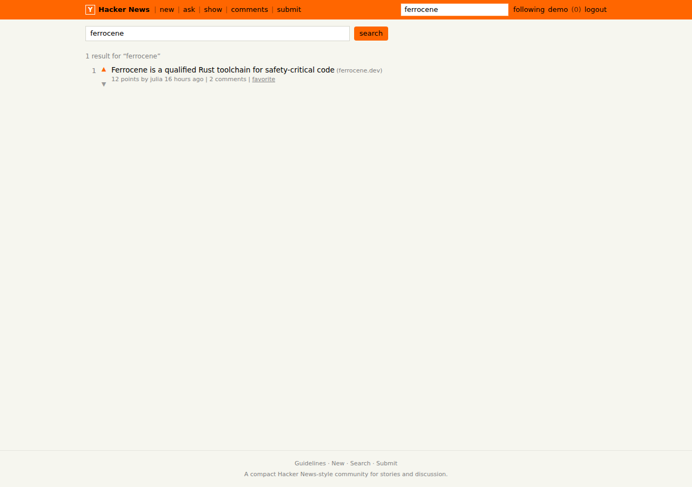

登录：

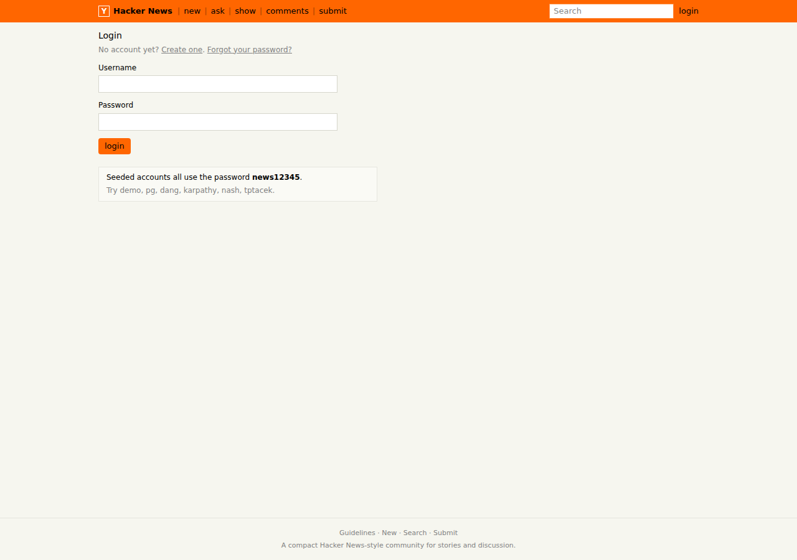

发帖：

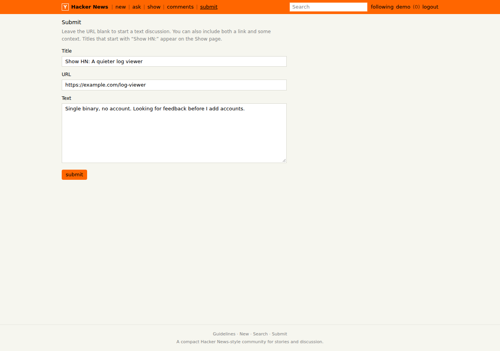

窄屏首页：

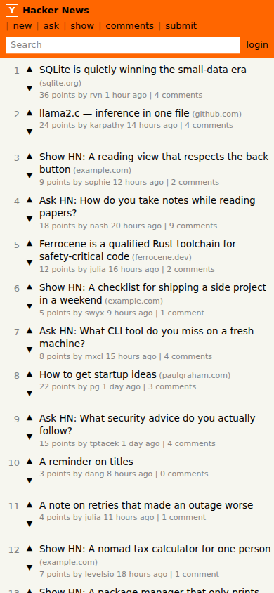

评论投票、软删除、收藏、粉丝数和关注页的图放在上面对应功能旁边，文件分别是 `comment-vote.png`、`comment-deleted.png`、`profile-favorites.png`、`profile-following-count.png`、`following-page.png`。

反对票、邮箱验证、密码重置和深层评论：

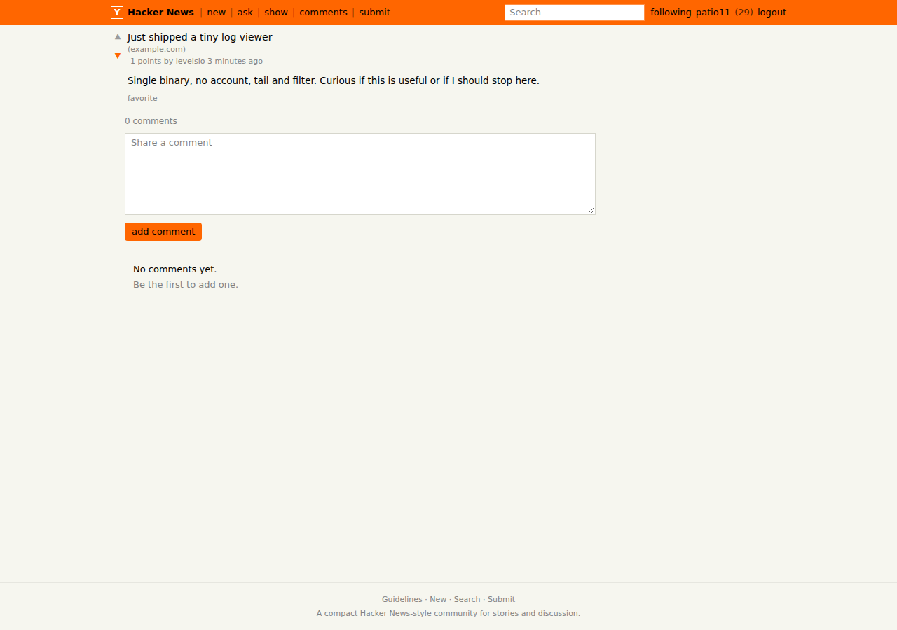

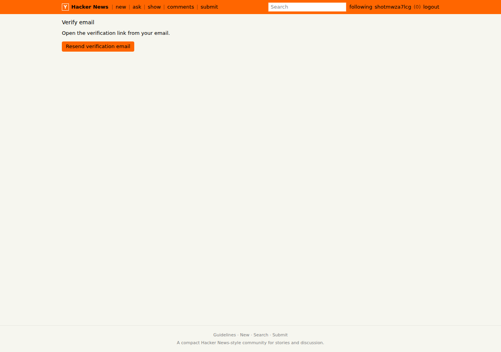

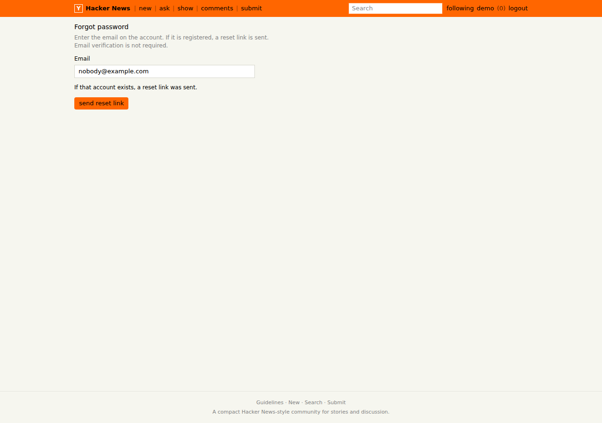

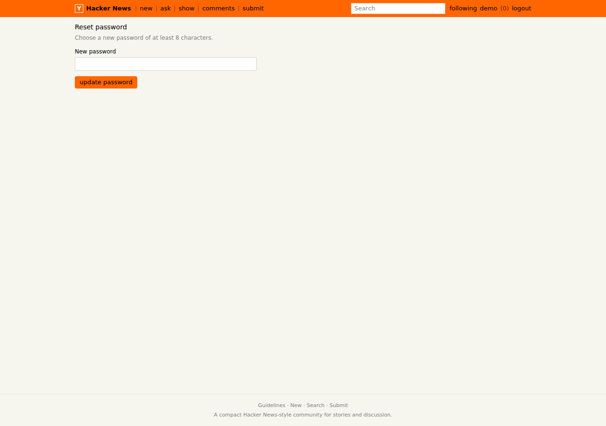

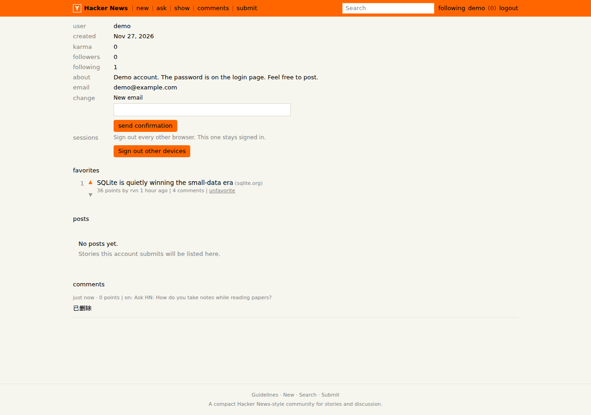

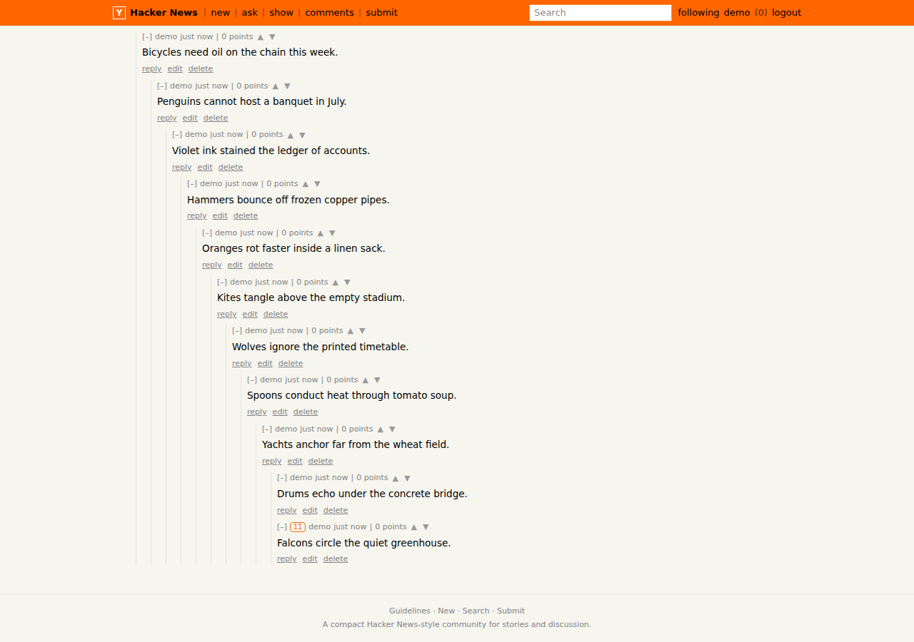

## 目录

- `app/(feed)/` 首页、`newest`、`ask`、`show`、`comments`、`search`、`following`
- `app/(account)/` `login`、`register`、`submit`
- `app/item/[id]/` 帖子和评论
- `app/user/[username]/` 个人主页（karma、followers、following、收藏、帖子、评论）
- `app/guidelines/`
- `components/` 列表、投票、评论树、收藏按钮、关注按钮、表单
- `lib/domain/` 热度 `ranking.ts`、分页 `pagination.ts`、评论树 `comments.ts`、编辑删除 `comment-moderation.ts`、收藏关注 `social.ts`、速率 `rate-limit.ts`、重复检测 `duplicate.ts`、搜索、karma
- `lib/actions/auth.ts`、`lib/actions/posts.ts`、`lib/actions/comments.ts`、`lib/actions/votes.ts`、`lib/actions/social.ts`、`lib/actions/comment-collapse.ts`
- `lib/auth-secret.ts` 与 `instrumentation.ts`：启动时拒绝缺失、占位符或过短的 `AUTH_SECRET`
- `prisma/` schema、迁移和种子数据
- `scripts/scale-bench.ts` 规模测量，`scripts/capture-screenshots.mjs` 截图
- `tests/unit`、`tests/e2e`
